 

## 👋 About me

I build low-level media and graphics software for the PS5. I work close to the hardware: GPU command buffers, hardware video decoders, audio output and shaders. I also reverse engineer system libraries to find out how the console really does things, then write it up so others can use it.

## 🎬 EVO Player

[**EVO-PLAYER-PS5**](https://github.com/sainsaji/EVO-PLAYER-PS5) is a native media player for jailbroken PS5 (firmware 12.70), shipped as an app module. It is written in C++ against the PS5 Payload SDK.

| | |
|---|---|
| **Video** | Hardware decode through `sceVideodec2`, with an FFmpeg fallback. 4K HEVC Main10 and AV1 work. |
| **Audio** | Bitstream passthrough (AC-3) straight to your receiver. |
| **Picture** | GPU upscaling with FSR1 and Anime4K, in several quality levels. |
| **UI** | Its own screens, drawn on bare-metal `sceAgc` with RmlUi. No system UI toolkit. |
| **Sources** | Built-in IPTV, Xtream, Emby, Jellyfin, Stremio and Nuvio providers. |
| **Tooling** | Remote control over the network, a host-side UI renderer, and a Docker toolchain for repeatable builds. |

## 🔬 Research

- [**PS5-Audio-Passthrough-Research**](https://github.com/sainsaji/PS5-Audio-Passthrough-Research): how to send raw Dolby and DTS audio from a PS5 app to a receiver.
- [**ps5-upscalar-research**](https://github.com/sainsaji/ps5-upscalar-research): notes and tools on upscaling on the PS5 GPU.

## 🧰 Other projects

- [**ColabBlenderRender**](https://github.com/sainsaji/ColabBlenderRender): render Blender scenes on Google Colab.
- [**ESP32_Simulator**](https://github.com/sainsaji/ESP32_Simulator): an ESP32 simulator in C++.
- [**MPC-BE**](https://github.com/sainsaji/MPC-BE): my fork of the Windows media player.

## 🛠️ Tech

**Focus areas:** video and audio decode, GPU rendering (sceAgc, shaders), reverse engineering, homebrew and embedded.

## 📫 Reach me

Open an issue on any repo above, or email [sain.sajix@gmail.com](mailto:sain.sajix@gmail.com).

If EVO Player is useful to you, a star on the repo helps a lot.

